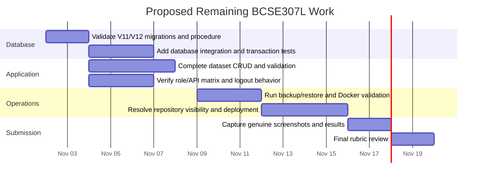

# Project Plan

The chart below is a **proposed remaining-work schedule**, not a record of
historical team activity. Dates are estimates and should be adjusted to the
course calendar. No individual assignments are implied.

## Phase tracking

Actual repository work and validation status are maintained in
[docs/BUILD_PROGRESS.md](../BUILD_PROGRESS.md). Any schedule changes or team
assignments must be confirmed by the project team.
