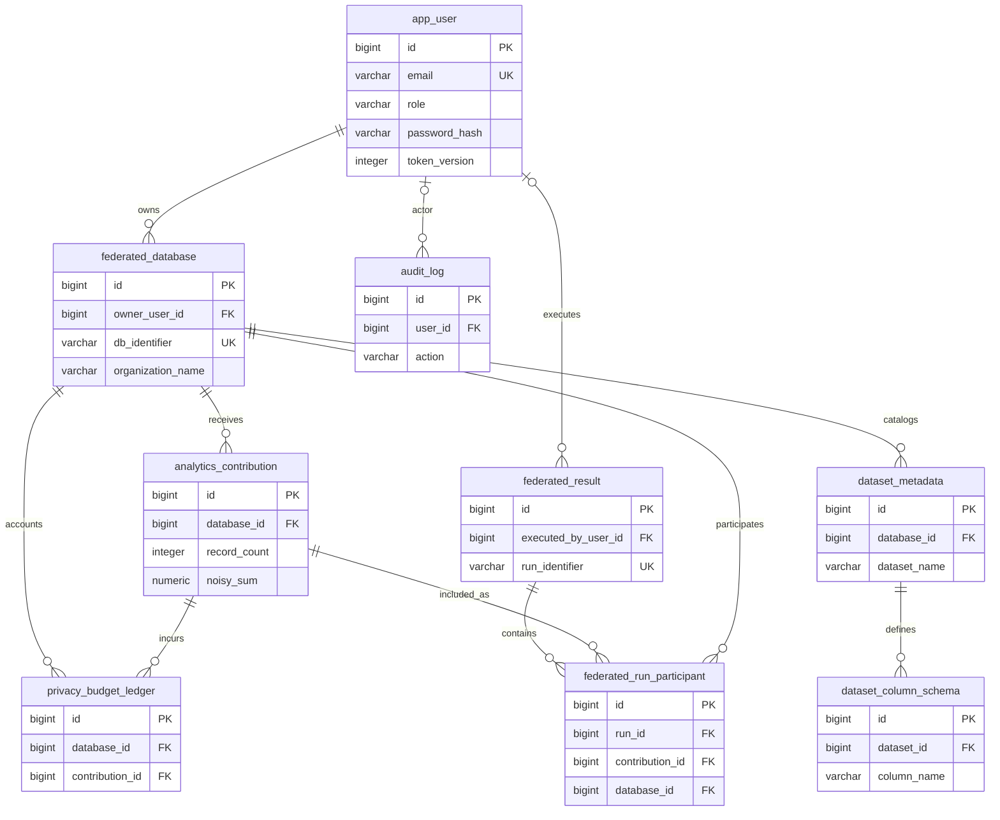

# Database ER Diagram

This diagram reflects the common Flyway migrations V1-V9. `federated_database`
is the existing organization/database boundary; a separate organization table
does not exist. A persisted aggregation run is represented by
`federated_result`.

The V9 read-only views are `v_organization_contribution_summary` and
`v_federated_analytics_overview`. They are not base tables and are omitted from
the relationship diagram.
